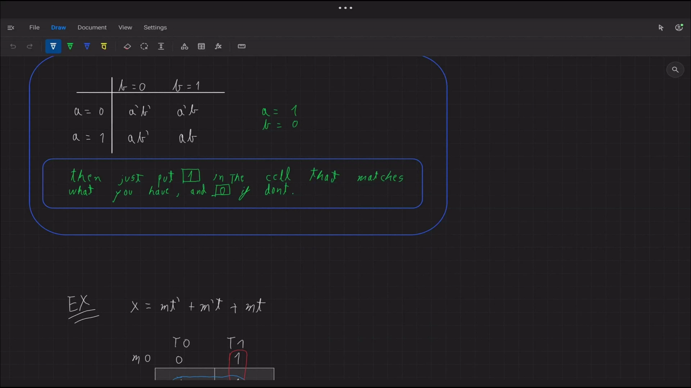
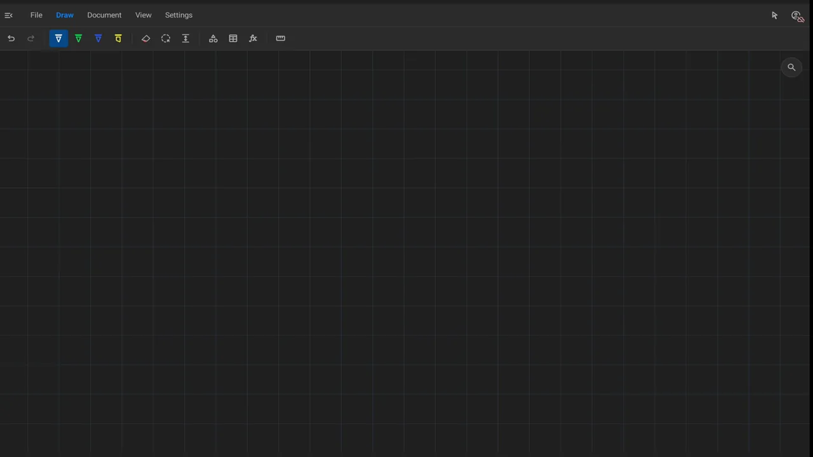
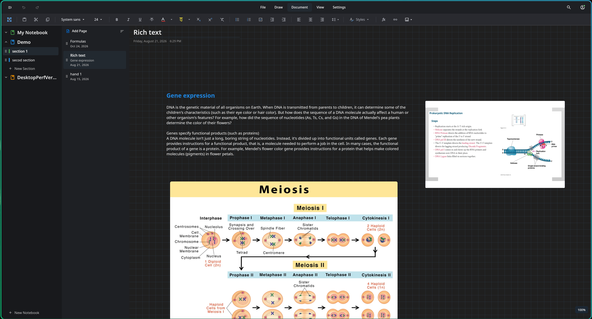
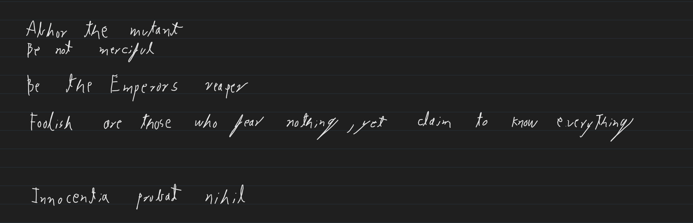
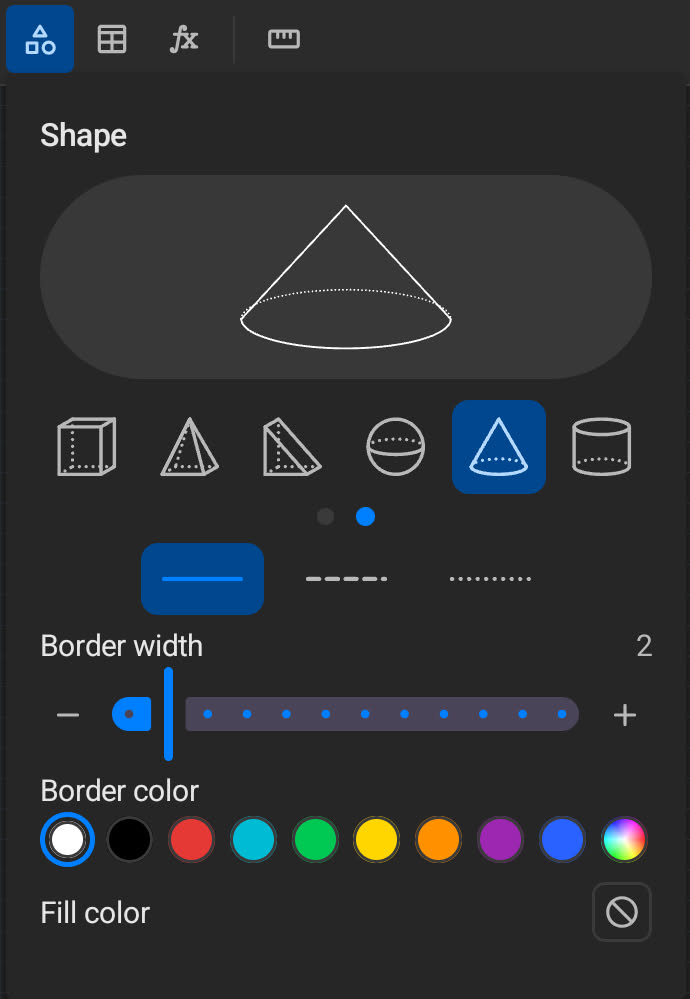
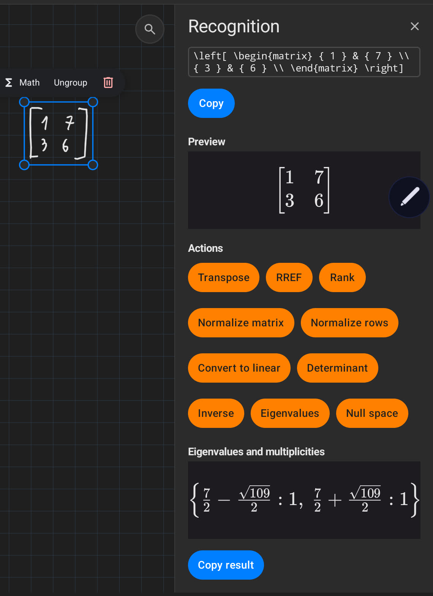
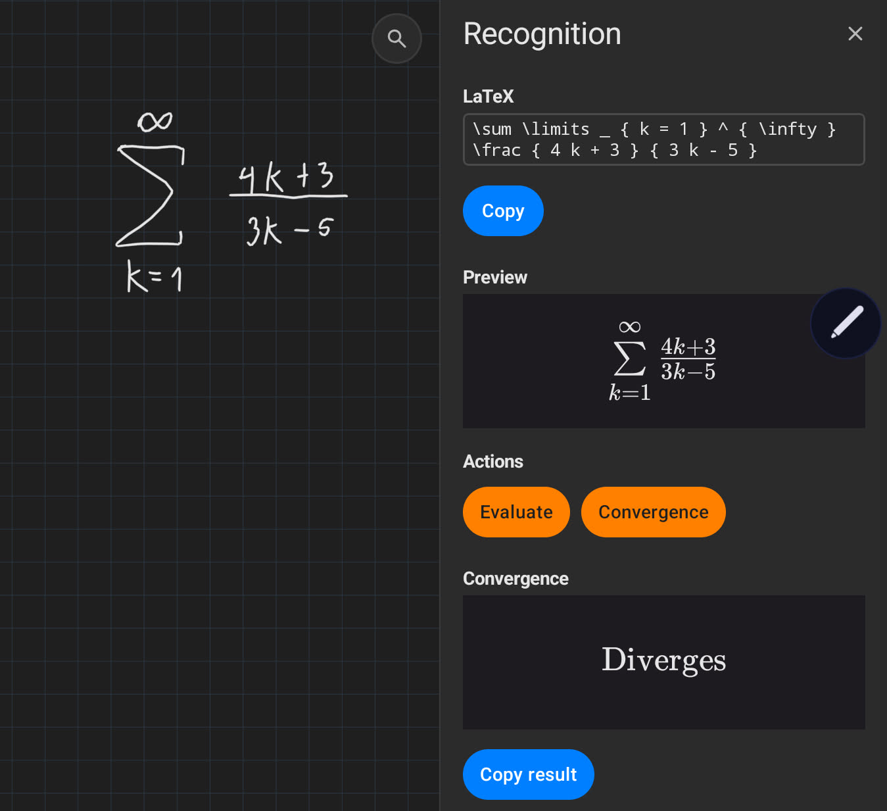

<a href='#'> 

# Vive Notes Desktop

A handwritten note-taking app built for students, combining the natural feel of pen and paper with the power
of digital documents.

All features are completely free, including cross-device sync. Your notes stay private: no data leaves your device,
and all AI features run entirely on-device.

This is the port of the android client [Vive Notes](https://github.com/AquilaIgnis/viveNotes)

# Download

<table>
  <thead>
    <tr>
      <th>Linux</th>
      <th>Google Play</th>
      <th>Windows</th>
    </tr>
  </thead>
  <tbody>
    <tr>
      <td align="center">
        <a href="https://vivenotes.net/#download">
          
        </a>
      </td>
      <td align="center">
        <a href="https://play.google.com/store/apps/details?id=com.vivenotes">
          
        </a>
      </td>
      <td align="center">
        <a href="">
          
        </a>
      </td>
    </tr>
  </tbody>
</table>

# Features

- Support for high DPI screens 144p and 4k.
- 1 to 1 parity with androidx Ink through ByteInk
- Local storage and AI processing on device.
- Fuzzy notebook search across text, tables, handwriting, and text found inside images.
- On-device handwriting and formula recognition, including math solving, evaluation, and graphing tools [docs](https://github.com/AquilaIgnis/viveNotes/blob/master/docs/calculator.md).
- Highly performant Ink rendering (7ms on over 10k strokes).
- Free-form page infinite canvas.
- Rich-text editing.
- Inline and free-form LaTeX equations with native rendering.
- Handwriting with configurable pens, pressure, smoothing.
- On-device image OCR.
- Custom paper: ruled, multiple grid sizes, dotted, hexagonal.
- Automatic database snapshots, and revision restoration.
- Open source export file format .vive , [docs](https://github.com/AquilaIgnis/viveNotes/blob/master/docs/viveFormat.md).
- Hardware keyboard shortcuts and configurable stylus buttons mappings.

[Demo Video](https://youtu.be/QZ6rd2uQD9E)

# Self Host your server

[Sync Server](https://github.com/AquilaIgnis/viveCServer)

# Gallery

| <a href='#acidburnmonkey'>  </a>    |
| ------------------------------------------------------------------------------- |
| <a href='#acidburnmonkey'>  </a> |
| <a href='#acidburnmonkey'>  </a>   |

| <a href='#acidburnmonkey'>  </a> | <a href='#acidburnmonkey'>  </a> |
| ---------------------------------------------------------------------- | ----------------------------------------------------------------------- |
| <a href='#acidburnmonkey'>  </a> | <a href='#acidburnmonkey'>        |

# Build from source

## Desktop

Use a current JDK with `jpackage` available (JDK 25 is recommended).

The default on linux is wayland

```bash
./gradlew :desktopApp:assemble
#or
./gradlew clean :desktopApp:assemble --no-build-cache --rerun-tasks Pkotlin.incremental=false
```

```bash
./gradlew :desktopApp:run
# tests
./gradlew :shared:jvmTest :desktopApp:test
```

Force x11 backed

```bash
:desktopApp:run --args='--x11'
```

Compose hot reload:

```bash
./gradlew :desktopApp:hotRun --auto
```

## Wasm

```bash
./gradlew wasmJsBrowserDevelopmentRun
```
